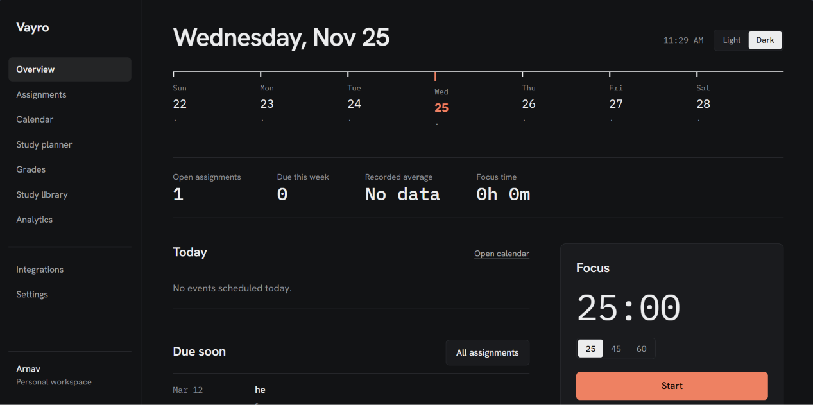

# VAYRO



**Your academic work, organized in one calm workspace.**

VAYRO is a responsive, browser-based academic workspace for planning assignments, tracking grades, managing study tasks, and building a consistent study routine. It has no account requirement, backend, or external dependencies.

## Features

- **Daily overview** - See open assignments, upcoming deadlines, today's schedule, and focus time at a glance.
- **Assignments** - Create, search, filter, complete, and delete assignments.
- **Calendar** - Schedule classes, tests, study sessions, and personal events.
- **Study planner** - Break coursework into manageable study tasks.
- **Grades** - Record scores and calculate subject averages automatically.
- **Study library** - Save useful links, notes, guides, videos, and resources.
- **Analytics** - Review assignment completion, focus time, and performance by subject.
- **Focus timer** - Run 25, 45, or 60-minute study sessions.
- **Calendar export** - Download VAYRO events as an `.ics` file.
- **Local backups** - Export and import workspace data as JSON.

## Screenshots

Screenshots will be added as the interface is finalized.

## Getting started

VAYRO runs directly in the browser. No package installation or build step is required.

### Option 1: Open locally

Clone the repository and open `index.html`:

```bash
git clone https://github.com/arnavseth12/VAYRO.git
cd VAYRO
open index.html
```

On Windows, use `start index.html`. On Linux, use `xdg-open index.html`.

### Option 2: Run a local server

From the project directory:

```bash
python3 -m http.server 3000
```

Then visit [http://localhost:3000](http://localhost:3000).

## How data is stored

VAYRO stores workspace data in the browser using `localStorage`. The app does not send profile, assignment, grade, or study data to a server.

Use **Settings > Backup** to export or import a JSON backup. Clearing browser storage removes locally saved VAYRO data.

## Project structure

```text
index.html       Daily overview and focus timer
assignments.html Assignment management
calendar.html    Calendar and event planning
planner.html     Study task planner
grades.html      Grade tracking
materials.html   Study resource library
analytics.html   Progress and performance analytics
integrations.html External tool links and calendar export
settings.html    Profile, backup, and data reset
app.js           Application logic and local data storage
styles.css       Responsive visual design
```

## Built with

- HTML5
- CSS3
- Vanilla JavaScript

## Roadmap

- Add a complete interface screenshot
- Improve cross-device data backup
- Expand notifications and deadline reminders
- Add deeper progress visualizations

## Contributing

Contributions are welcome. Please open an issue to suggest a feature or report a problem before starting significant work.

If you find VAYRO useful, consider giving the repository a star.
